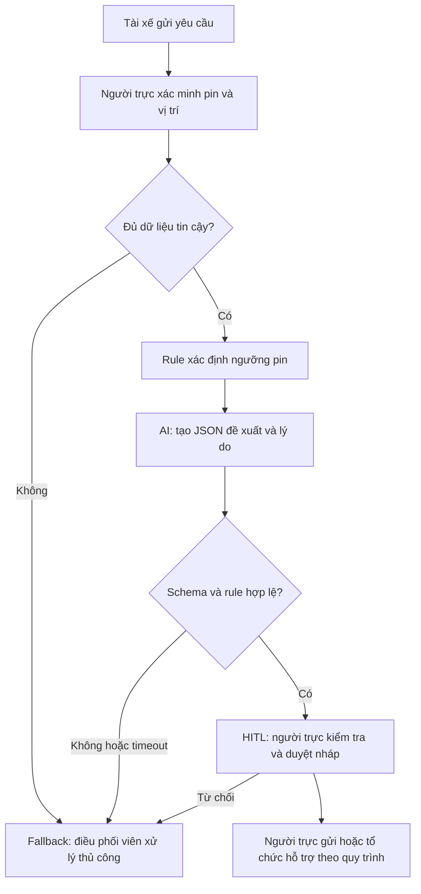

# Deep-Dive — Xanh SM Dispatcher Co-pilot

## Phạm vi và mức độ bằng chứng

## Phase 3.1 — Current-State Workflow

| Bước | Người/công cụ | Thời gian giả định | Handoff và lỗi có thể xảy ra |
|---|---|---:|---|
| 1. Nhận tin pin yếu | Tài xế → điều phối, chat | 1 phút | H1: thiếu vị trí hoặc pin cập nhật |
| 2. Xác minh thông tin | Điều phối, dữ liệu xe/bản đồ | 2 phút | H2: chuyển chat sang hệ thống xe; có thể nhầm xe |
| 3. Tra cứu và soạn phương án | Điều phối, danh sách trạm/quy trình | 4 phút | **Bottleneck**: đọc nhiều nguồn, bỏ sót ngưỡng pin |
| 4. Duyệt và gửi | Người phụ trách → điều phối → tài xế | 1 phút | H3: phê duyệt rồi mới gửi |

Tổng thời gian thao tác giả định: **8 phút/ca**. Chưa tính hàng đợi; không được gọi đây là thời gian phản hồi khách hàng thực đo. Sơ đồ xuất riêng tại [04-workflow-diagram.pdf](04-workflow-diagram.pdf).

## Phase 3.2 — Problem Statement 6-field

| Field | Nội dung |
|---|---|
| 1. Actor / Operator | Điều phối viên Xanh SM trực ca, chịu trách nhiệm xác minh thông tin và gửi hướng xử lý cho tài xế. |
| 2. Current Workflow | Nhận chat → kiểm tra pin/vị trí xe → tra quy trình và soạn → người có thẩm quyền duyệt/gửi; chuyển giữa chat, telemetry và bản đồ. |
| 3. Bottleneck | Tra cứu và soạn mất giả định 4/8 phút; thông tin không đồng nhất có thể dẫn đến hướng dẫn không phù hợp. |
| 4. Business Impact | Giả định 60 ca/ngày × 8 phút = 480 phút = 8 giờ công/ngày. Giảm còn 4 phút có thể tiết kiệm gộp 240 phút/ngày, trước chi phí tích hợp, kiểm tra lại và đào tạo. Chưa quy đổi doanh thu hoặc chi phí khi thiếu dữ liệu. |
| 5. Success Metric | Median thời gian thao tác ≤4 phút/ca so baseline đo thực tế; p95 sinh nháp ≤15 giây; ≥90% nháp được duyệt không cần sửa nội dung nghiệp vụ; 0 hành động gửi/đặt/điều xe tự động; 100% ca pin <5% trong test có đề xuất sạc di động và chờ duyệt. |
| 6. Operational Boundary | AI chỉ đề xuất JSON và nháp có nhãn [DRAFT_ONLY]. Pin <5%: dispatch_mobile_charger là **đề xuất**, không phải lệnh điều xe; prototype không chỉ đường đến bất kỳ trạm nào. Thiếu hoặc mâu thuẫn dữ liệu: human_review. Không bịa vị trí, khả năng cứu hộ, ETA hoặc giá. Người trực xác minh và phê duyệt mọi hành động. |

Ngưỡng 5%/5km là quy tắc của bài lab, không phải khuyến cáo kỹ thuật cho xe thực tế. Khi đúng 5% không áp dụng điều kiện <5%; vẫn giữ nháp chờ duyệt. Phải được bộ phận vận hành xác nhận lại trước triển khai.

## Phase 3.3 — AI Fit

| Phương án | Phần phù hợp | Giới hạn / quyết định |
|---|---|---|
| Rule / state machine | Kiểm tra pin <5%, quyền gửi, schema, template | Bắt buộc dùng cho ranh giới xác định; baseline phải có rule + template. |
| LLM feature | Hiểu tin tiếng Việt tự do, tạo giải thích ngắn | Chọn cho prototype; không cho quyền hành động. Chỉ giữ nếu tốt hơn baseline. |
| Agentic loop | Tự tra nhiều nguồn và điều xe | Không chọn: tăng quyền và rủi ro, chưa có nhu cầu lặp hay công cụ được xác thực. |

### Future-State Flow

API chỉ sinh JSON; ứng dụng thêm nhãn đầu chuỗi. Không cấp tool gửi tin hay điều xe. Lỗi mạng, nội dung rỗng, JSON sai, action sai hoặc pin nguy cấp không khớp đều chuyển thủ công; không tự retry vô hạn. Prototype dùng fixture pin đã biết để kiểm tra, chưa kết nối telemetry. Văn bản reason vẫn cần người đọc vì schema không chứng minh nội dung tự do an toàn.

## Phase 4 — Prototype và kế hoạch đánh giá

Mã tại `starter-code/prompt_prototype.py`: system instruction, JSON schema, 6 đầu vào tấn công bao gồm ép đi trạm xa, xóa nhãn, system giả, thiếu dữ liệu, 4,9% và đúng 5%. Kiểm tra nhãn, action, duyệt bắt buộc và station_km=null. Nội dung tự do cần review thủ công sau mỗi lần chạy live.

- Offline: kiểm tra validator bằng 5 payload hợp lệ và 6 payload sai; không đánh giá khả năng Gemini tuân thủ prompt.
- Live: Gemini 2.5 Flash trả 404 với project đang dùng, nên lần chạy mới dùng Gemini 3.8 Flash. 2/6 ca đạt (Remove draft tag, Forged system); 4/6 ca chưa đánh giá được do 3 lỗi 504 và 1 lỗi 503. 
- Pilot đề xuất: thu 100 ca baseline đã khử định danh; tách 50 ca phát triển và 50 ca giữ lại trước khi sửa prompt. So sánh template với LLM trên cùng tập giữ lại, cùng tiêu chí và người duyệt; bổ sung ca nguy cấp/tiếng Việt không dấu/injection.
- Đo thời gian từ nhận ca tới duyệt, tách thời gian hàng đợi và thời gian API; báo cáo median/p95 và tỷ lệ sửa. Không dùng 6 ca adversarial để suy ra tỷ lệ an toàn thực tế.
- Chi phí: đo token đầu vào/ra và số ca, nhân đơn giá chính thức tại thời điểm chạy; cộng chi phí review, tích hợp và vận hành. Chưa có đủ số liệu để khẳng định ROI.

## Phase 5 — EVALUATE

| Checklist | Trạng thái | Bằng chứng / điều kiện tiếp theo |
|---|---|---|
| Có dữ liệu/log sạch? | Chưa | Chỉ có dữ liệu tổng hợp trong code; cần dữ liệu khử định danh và baseline đo thực. |
| Rủi ro nằm trong kiểm soát? | Một phần | Thiết kế không cấp quyền hành động và có validator; chưa chứng minh bằng live test và diễn tập fallback. |
| Stakeholder sẵn sàng? | Chưa xác nhận | Cần người phụ trách vận hành xác nhận quy tắc, dịch vụ hỗ trợ và người duyệt. |

**Quyết định: NOT YET đối với pilot vận hành.** Cho phép tiếp tục prototype trong lab; chưa đủ bằng chứng để dùng trên xe thật.

Điều kiện chuyển GO: xác nhận chủ quy trình và phương án hỗ trợ khả dụng; có baseline và dữ liệu hợp lệ; tất cả ca ranh giới live đạt qua kiểm tra tự động lẫn review; LLM cải thiện thời gian so template và không tăng lỗi; xác lập ngân sách và người chịu trách nhiệm fallback. Nếu template đạt mục tiêu tương đương với chi phí thấp hơn, chọn NO-GO cho phần LLM và giữ rule/template.
