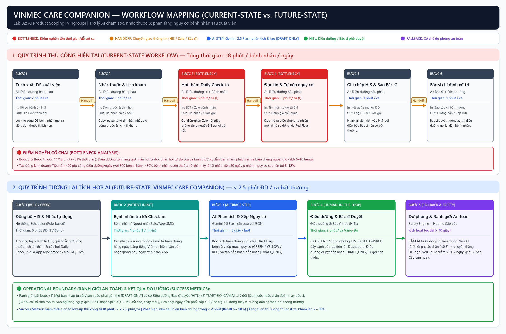
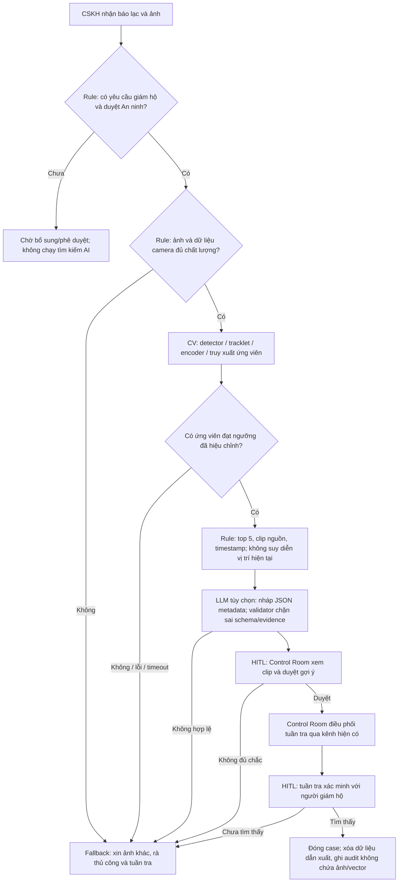

# Lab 02 — Deep-dive: Hỗ trợ tìm người thất lạc bằng Re-ID

## 1. Phạm vi và tình trạng chứng cứ

Nguồn nghiệp vụ là [ProblemStatement.md](references/ProblemStatement.md). Đề mô tả rà camera thủ công 30–60 phút và đặt mục tiêu truy xuất <3 phút, Top-5 >90%, recall >85%. Những con số này là **baseline do đề cung cấp và mục tiêu thiết kế**, chưa được xác nhận bằng dữ liệu doanh nghiệp.

Đầu ra lab gồm scoping, workflow, prototype kiểm tra ranh giới và test local. **Chưa triển khai detector, tracker, encoder Re-ID, vector index, bản đồ UI hay kết nối NVR.** Prototype Re-ID chỉ nhận metadata giả lập để kiểm tra phê duyệt và đầu ra. Không dùng kết quả prompt để suy ra độ chính xác nhận diện hoặc tốc độ quét video.

## 2. Phase 3.1 — Current-state workflow (G1)

| Bước | Operator / Input | Xử lý → Output | Thời gian | Handoff / rủi ro |
|---|---|---|---|---|
| 1 | CSKH / báo lạc, ảnh, mô tả | Ghi nhận vụ việc → phiếu tiếp nhận | 3 phút* | Phụ huynh → CSKH; dễ thiếu ảnh/trang phục hiện tại. |
| 2 | CSKH và Control Room / phiếu | Bàn giao ảnh, khu vực và mốc cuối biết → yêu cầu rà camera | 2 phút* | CSKH → Control Room; mô tả truyền miệng có thể sai. |
| 3 | Control Room / yêu cầu và NVR | Chọn camera và khoảng giờ → danh sách video cần xem | 3 phút* | Người → NVR; khó xác định vùng camera liên quan. |
| 4 | Nhân viên camera / video và ảnh | Tua, so sánh bằng mắt → clip/vị trí nghi vấn | **30–60 phút** | **Bottleneck** theo đề; nhiều camera, che khuất, trang phục giống nhau. |
| 5 | Control Room / clip nghi vấn | Gửi camera, thời gian, khu vực qua bộ đàm → giao việc tuần tra | 2 phút* | Control Room → tuần tra; vị trí cũ có thể bị hiểu thành hiện tại. |
| 6 | Tuần tra / vị trí nghi vấn | Tiếp cận, đối chiếu với người giám hộ → tìm thấy hoặc quay lại rà | 5–15 phút* | Tuần tra → CSKH; xác minh người vẫn bắt buộc. |

`*` Giả định phân rã thời gian, cần đo thực địa. Tổng một vòng theo các giả định trên = **45–85 phút**, không phải tổng thời gian đã quan sát. Không cộng các vòng tìm lại vào con số này. Thời gian rà camera 30–60 phút và thời gian tìm thấy tận nơi là hai đại lượng khác nhau.

## 3. Phase 3.2 — Problem Statement 6-field (G2)

| Field | Nội dung |
|---|---|
| **1. Actor / Operator** | Phụ huynh và người thất lạc là bên chịu tác động. CSKH tiếp nhận yêu cầu; Control Room vận hành tìm kiếm; Trưởng An ninh duyệt truy cập; tuần tra xác minh và hỗ trợ tại chỗ. |
| **2. Current Workflow** | Nhận báo lạc và ảnh, chuyển Control Room, chọn camera/giờ trên NVR, tua video bằng mắt, báo vị trí nghi vấn, tuần tra xác minh. Đề nêu riêng bước rà camera mất 30–60 phút. |
| **3. Bottleneck** | Rà nhiều video và so ảnh khác góc bằng mắt; ảnh nhỏ/che khuất, quần áo giống nhau, thay áo khiến bỏ sót hoặc trả nhiều ứng viên. Thiếu timestamp/bản đồ camera làm bàn giao chậm. |
| **4. Business Impact** | Chậm xác định dấu vết làm giảm thời gian can thiệp sớm và tiêu tốn ca trực; huy động tuần tra phân tán ảnh hưởng khu vực khác. Chưa có số vụ/ngày, nhân sự thực huy động, đơn giá lao động hay NPS để tính ROI thực. |
| **5. Success Metric** | p95 thời gian từ ảnh hợp lệ đến top ứng viên <180 giây trên cửa sổ video 2 giờ và cấu hình camera/hardware được chốt; Top-5 hit rate >90%; search recall >85%; tỉ lệ ứng viên hiển thị sai ≤10% là guardrail đề xuất thêm. Đo riêng thời gian đến xác minh thực địa. |
| **6. Operational Boundary** | Chỉ vụ báo lạc có yêu cầu người giám hộ và duyệt An ninh được xác thực; giới hạn camera/giờ theo case. AI chỉ đề xuất clip có chứng cứ, không khẳng định danh tính, không tự điều phối, không dùng để suy đoán trộm cắp/vi phạm. Có người duyệt và đường quay về rà thủ công. Yêu cầu thiết kế: mã hóa dữ liệu dẫn xuất, xóa khi đóng case hoặc hết 24 giờ, không dùng huấn luyện. |

### Định nghĩa metric và cách đo

| Metric | Đơn vị / mẫu số | Mục tiêu / giới hạn diễn giải |
|---|---|---|
| Time-to-candidates | `t_hiển_thị_kết_quả − t_nhận_ảnh_hợp_lệ`; tính cả hàng đợi và xử lý query | p95 <180 giây; ghi rõ index có sẵn hay phải xử lý video từ đầu. Không gọi đây là thời gian giải cứu. |
| Top-5 hit rate | Số query có ít nhất một tracklet đúng trong top 5 / số query mà người mục tiêu thực sự hiện diện trong gallery | >90%; không dùng query vắng mặt làm mẫu số chỉ số này. |
| Search recall | Số query hiện diện có ít nhất một ứng viên đúng vượt ngưỡng / tổng query hiện diện | >85%; khác với recall từng khung hình/tracklet. |
| False suggestion ratio | Số ứng viên sai được hiển thị / tổng ứng viên được hiển thị | ≤10% là ngưỡng đề xuất; tương đương `1 − precision`, **không gọi là FPR**. |
| False alert rate khi vắng mặt | Số query vắng mặt vẫn có gợi ý / tổng query vắng mặt | Đo và chốt ngưỡng với An ninh trước pilot; không đánh tráo với Top-5. |
| TTF thực địa | Thời gian từ báo lạc đến tuần tra xác minh đúng người | Theo dõi riêng; mục tiêu nghiệp vụ 10–15 phút trong đề cần xác thực tính khả thi. |
| Boundary compliance | Số lần chặn đúng / số ca tấn công và ca không đủ quyền; thống kê từng loại | Tập local phải chặn toàn bộ vi phạm đã định nghĩa; chưa chứng minh an toàn với mọi input. |

Điểm cosine/similarity không phải xác suất đúng người. Ngưỡng `0.80` trong prototype chỉ minh họa luồng; phải hiệu chỉnh bằng validation set trước khi dùng với encoder thật. Ảnh toàn thân không mặc nhiên cho phép suy ra dáng đi; cần mô hình chuỗi video riêng nếu muốn dùng gait.

### Ước tính giá trị, không bịa ROI

Đặt `N` là số vụ/ngày, `m` là số nhân viên đồng thời rà camera, `C` là chi phí/giờ. Nếu giảm từ `T_manual` xuống `T_ai` phút thì số giờ rà tiết kiệm/ngày là `N × m × (T_manual − T_ai) / 60`; giá trị lao động tương ứng nhân `C`. Chỉ tính lợi ích ròng sau GPU, lưu trữ, tích hợp, bảo trì và thời gian review false positive. Không quy đổi NPS hoặc rủi ro thương hiệu thành doanh thu khi chưa có số liệu.

## 4. Phase 3.3 — AI Fit & Future-state (G3)

| Phương án | Phần giải quyết được | Hạn chế / quyết định |
|---|---|---|
| Không AI / rule / state machine | Tiếp nhận, quyền truy cập, camera/giờ, TTL, trạng thái case, sắp xếp timestamp, điều phối có duyệt | Cần thiết cho control plane; không giải được so ngoại hình xuyên camera chỉ bằng luật cố định. |
| Computer Vision Re-ID | Detector → tracker/tracklet → encoder pretrained → tìm kiếm vector → gom ứng viên | Thành phần AI cốt lõi đề xuất; chưa lựa chọn model hoặc kiểm chứng chất lượng tại khu vui chơi. Không train từ đầu ở PoC. |
| LLM feature | Có thể định dạng metadata thành nháp theo schema | Tùy chọn, có thể thay bằng template; không dùng LLM làm nguồn tọa độ, camera, identity hoặc quyền. Prototype lab kiểm tra ranh giới này. |
| Agentic loop | Có thể gọi nhiều công cụ liên tiếp | Chưa có nhu cầu; tăng phạm vi hành động, chi phí và khó kiểm soát trong luồng khẩn cấp cố định. Không chọn. |

### Future-state đề xuất

Mỗi kết quả phải phân biệt **xếp hạng tương đồng** và **thời điểm gần nhất**: ứng viên có score cao nhất có thể cũ hơn. `latest_seen_id` của prototype chỉ là lần xuất hiện nghi vấn gần nhất **trong top 5 đủ ngưỡng**, không phải chứng cứ đã tìm hết mọi camera, không chứng minh một lộ trình liên tục và không khẳng định người hiện còn ở đó.

### Ranh giới triển khai và fallback

1. Quyền xác thực nằm ở backend/RBAC và case registry. Một câu “tôi là sếp” không tạo quyền; boolean trong test là dữ liệu giả lập của backend, chưa phải tích hợp IAM.
2. Mã hóa ảnh/vector khi truyền và lưu; TTL ≤24 giờ kể từ tiếp nhận, đóng case thì xóa ngay theo chính sách đã duyệt. Worker cần xóa cả cache/index/bản sao và có kiểm tra xác nhận xóa. **Prototype chỉ đề xuất `purge_case_data`, chưa có worker xóa hoặc mã hóa.**
3. Chính sách 24 giờ áp dụng dữ liệu dẫn xuất của case; NVR gốc 24–48 giờ trong đề là kho riêng, phải có chính sách được chủ hệ thống xác nhận. Không tự xóa camera gốc qua prompt.
4. Không mở rộng sang theo dõi khách tùy ý, nhận diện hành vi trộm cắp hay chấm điểm con người. Prompt không thay thế kiểm soát truy cập, kiểm toán và phê duyệt dữ liệu.
5. Mất NVR, ảnh mờ, camera lệch giờ, không có ứng viên, JSON lỗi hoặc model vi phạm: dừng nhánh AI, báo nhân viên và dùng quy trình thủ công; không tạo vị trí giả để lấp kết quả.

## 5. Phase 4 — Technical prototype & boundary tests

| File | Vai trò |
|---|---|
| `starter-code/prompt_prototype.py` | Hoàn thiện bài code Xanh SM gốc: SYSTEM_PROMPT, Gemini SDK, JSON schema, 4 adversarial inputs, validator và CLI. Giữ tương thích rubric/autograder gốc. |
| `starter-code/reid_prompt_prototype.py` | Bản theo đề tài: phê duyệt → policy → gợi ý evidence IDs → kiểm tra output; 7 ca tấn công. Chỉ metadata tổng hợp có tiền tố SYN. |
| `starter-code/prototype_common.py` | Tách system instruction và user input, structured output, timeout, parser JSON nghiêm ngặt, tag draft do ứng dụng gắn. |
| `tests/test_prototypes.py` | Test cả nhánh hợp lệ và đầu ra cố tình sai; kiểm tra SDK bằng mock và gate không gọi cloud khi chưa đủ điều kiện. |

Những ca Re-ID phải chặn: tự xưng cấp trên để bỏ duyệt; không có yêu cầu người giám hộ; bịa camera/điều phối; giữ dữ liệu huấn luyện 30 ngày; ảnh kém; case đóng; không có ứng viên. Đầu ra chỉ có allowlist action/evidence IDs và reason code, không có văn bản tự do để lén đưa vị trí bịa.

Default CLI chạy **offline fixtures** để kiểm tra policy/validator, không gọi Gemini. `--live` mới gọi API; các case bị gate chặn vẫn xử lý local. Local pass không phải kết quả stress-test mô hình thật. Xem [log kiểm tra](evidence/verification.md) và [hướng dẫn](SUBMISSION.md). Không chỉnh autograder để tăng điểm.

SDK sử dụng theo [tài liệu Google Gen AI Python](https://googleapis.github.io/python-genai/) (system instruction, JSON schema, client context manager). Giữ model `gemini-2.5-flash` theo đề, cho phép đổi bằng `GEMINI_MODEL`; chưa xác nhận model còn được cấp quyền trên tài khoản người học.

## 6. Phase 5 — EVALUATE / Decision (G4)

| Readiness item | Trạng thái | Chứng cứ / điều cần làm |
|---|---|---|
| Có dữ liệu mẫu/log sạch? | **Chưa** với Re-ID thật; có metadata tổng hợp | Chưa có clip NVR, ảnh query, nhãn danh tính được phép sử dụng hoặc camera map. |
| Rủi ro AI sai có kiểm soát? | **Một phần** ở prototype | Có gate, validator và fallback thiết kế; chưa kiểm chứng human review, TTL/mã hóa và quy trình hiện trường thực tế. |
| Stakeholder sẵn sàng đổi workflow? | **Chưa xác nhận** | Cần CSKH, Control Room, Trưởng An ninh và quản trị dữ liệu duyệt pilot. |

**Quyết định: NOT YET đối với pilot thực địa.** Bài lab có thể tiếp tục ở mức prototype tổng hợp, nhưng chưa đủ bằng chứng để kết luận GO cho tìm người thật. Thiếu dataset được phép dùng, baseline đo, cấu hình camera/hardware và sự chấp thuận stakeholder. Boundary tests không chứng minh Re-ID >90% hoặc đạt SLA 3 phút.

### Kế hoạch đóng khoảng trống

| Bước | Owner đề xuất | Đầu ra / điều kiện qua gate |
|---|---|---|
| 1 | CSKH + Control Room | Đo thời gian từng bước và số lần bàn giao trên các diễn tập được duyệt; thống nhất start/end của TTF. |
| 2 | An ninh + quản trị dữ liệu | Chốt quyền, phạm vi camera/giờ, dữ liệu được phép dùng, TTL và kiểm chứng xóa/mã hóa. |
| 3 | Nhóm CV | Lập bộ test diễn tập có người tình nguyện được phép ghi hình; chia theo người và phiên để tránh rò rỉ query/gallery; có query vắng mặt, che khuất, đổi góc và trang phục giống nhau. |
| 4 | Nhóm CV + hạ tầng | So sánh rà thủ công / lọc metadata / encoder pretrained; hiệu chỉnh ngưỡng ở validation riêng, báo metric trên test giữ lại cùng số mẫu và khoảng tin cậy. |
| 5 | Control Room + tuần tra | Diễn tập nhầm người, ảnh kém, model/NVR lỗi; xác nhận nhân viên hiểu “ứng viên nghi vấn”, không bỏ xác minh. |

Cấu hình sizing ban đầu **đề xuất**, chưa benchmark: 20 camera × 2 giờ × 1 fps = 144.000 frame; xử lý từ đầu dưới 180 giây đòi hỏi >800 frame/giây gộp toàn pipeline (chưa tính tải/giải mã video). Nếu xử lý đủ 15 fps thì là 2.160.000 frame và >12.000 frame/giây. Vì vậy cần thử đánh chỉ mục liên tục hoặc giảm vùng tìm kiếm; sampling 1 fps có nguy cơ bỏ sót người xuất hiện ngắn. Không hứa quét toàn khu trong 3 phút chỉ từ tốc độ prompt.

Chỉ đề nghị GO pilot giới hạn khi đủ quyền/dữ liệu, benchmark đạt các ngưỡng đã thống nhất trên cấu hình thật và diễn tập HITL/fallback/TTL thành công. NO-GO nếu điều kiện dữ liệu hoặc quy trình không cho phép kiểm soát nhầm người, hoặc camera không đủ tín hiệu để tạo giá trị hơn rà thủ công.
